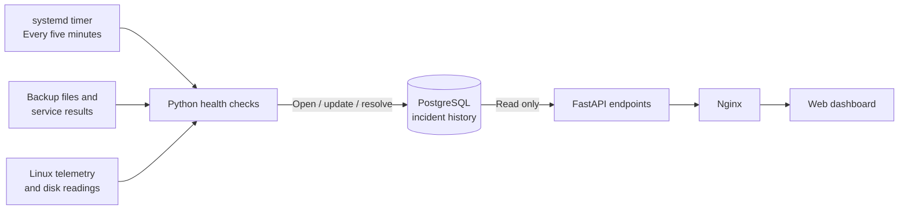

# Automated Infrastructure Monitoring and Incident Tracking

**Project:** Self-hosted homelab reliability monitoring
**Completed milestone:** October 2026
**Technologies:** Python, PostgreSQL, FastAPI, Nginx, systemd, Linux, JavaScript

## The problem

My homelab already collected system metrics and stored telemetry, but the dashboard originally relied on an open browser to identify stale readings. I wanted health checks that would run unattended, preserve failures as database records and show when an issue recovered, without adding a separate monitoring stack or notification service.

## Solution and architecture

I built a lightweight monitoring workflow around the infrastructure already running in the lab.

The worker and the dashboard have separate responsibilities: the scheduled worker evaluates system health and maintains incident state; the web API retrieves incident data for display. Monitoring continues even when nobody is viewing the dashboard.

## What is monitored

| Signal | First-phase behavior |
| --- | --- |
| Database backup freshness | Detect local dump age beyond a defined threshold |
| Backup job health | Check the last reported systemd service result |
| Replication job health | Check the last reported systemd service result |
| Remote Linux telemetry | Flag data that has stopped arriving |
| Remote disk usage | Warn when reported utilization exceeds 90% |
| Application-server disk usage | Warn when filesystem utilization exceeds 90% |

These are **six targeted checks**, not comprehensive monitoring for every host or application.

## Incident lifecycle

The incident table captures a stable condition key, category, severity, first and last detection times, status and recovery time. Each monitoring run either opens an incident, updates an existing open incident or resolves it when the condition returns to normal.

A PostgreSQL **partial unique index on the incident key for open rows** prevents duplicate open incidents. Historical resolved incidents remain available for troubleshooting, so recovery is part of the record rather than the disappearance of a warning.

The dashboard reads incidents through two REST endpoints: `/api/incidents/active` and `/api/incidents/history`. Its database identity receives only the read access required for those views; incident writes remain with the scheduled monitor.

## Verification

I tested the implementation incrementally rather than enabling automated writes immediately:

1. A read-only dry run reported **six healthy checks**.
2. A database-enabled run completed without creating false incidents.
3. A controlled test with a temporary PostgreSQL table verified incident creation, deduplication and automatic resolution, leaving production incident history unchanged.
4. The systemd timer was enabled for five-minute execution, and unattended journal logs showed successful completion.
5. Both new incident endpoints returned valid JSON. Existing inventory, maintenance, temperature and dashboard routes continued to return HTTP 200.
6. The maintenance log was expanded from three to ten records to document verified implementation milestones.

The tests demonstrate the incident lifecycle and deployment behavior in the tested environment. They do **not** establish long-term alert reliability or recovery from every real-world failure.

## Design decisions and lessons

- **Reuse the stack:** Python and PostgreSQL integrated cleanly with existing Linux administration tools, keeping overhead low.
- **Keep monitoring server-side:** A browser freshness indicator is useful, but it cannot be the sole failure detector.
- **Make failures stateful:** A persistent open incident is more useful than repeating the same warning every five minutes.
- **Treat recovery as an event:** Resolution timestamps make outages and troubleshooting history reviewable.
- **Use least privilege:** The web-facing API needs to read incidents, not modify their state.
- **Test safely:** Temporary tables allowed lifecycle testing without manufacturing production outages.

## Scope and next improvements

The first phase monitors local backup freshness and service results. It **does not independently validate the newest off-host backup file** on every cycle, and service success alone is not proof of restorable data. Future work includes direct replica integrity checks, periodic restore drills, archived application-database backup freshness, broader host/service coverage and improved access controls before any external exposure.

This case study intentionally omits internal addresses, account names, host identifiers, credentials, production configuration and personal data. The private operational repository retains detailed runbooks and deployment-specific evidence.

**Related projects:** [Infrastructure architecture](architecture.md) · [PostgreSQL backup and recovery](backup-and-recovery.md)
