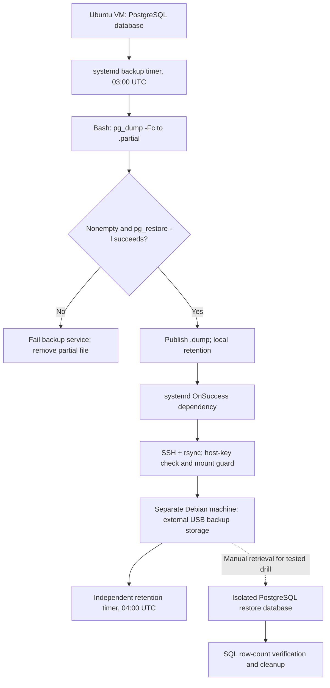

# Architecture and workflow

## Components

| Component | Function |
| --- | --- |
| Source Ubuntu VM | Runs the PostgreSQL dashboard database and backup/replication services |
| Local backup directory | Holds completed custom-format archives, separate from `.partial` files |
| systemd `OnSuccess=` | Starts replication only after the backup service finishes successfully |
| SSH/rsync | Transfers dumps to the second physical computer, with a destination mount precondition |
| Debian external storage | Holds independent backup copies and runs a separate retention job |
| Isolated restore database | Provides non-destructive validation of retrieved backup data |

## Important distinction

The operational system produces a *backup copy* on another host, not a synchronous replica of the running database. Transfer logs demonstrate service success; they do not replace periodic restore drills. The path to an independent backup copy reduces reliance on the VM but does not by itself satisfy full disaster recovery requirements.
